# Переработка модели кетбота — резюме

План: [plan.md](plan.md). Референсы: `references/catboat/`.

Состояние до начала работ: 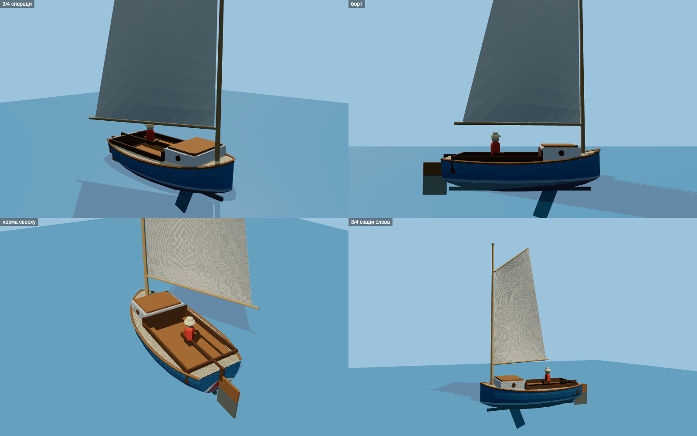

## Инструменты
- `src/debug/boat-viewer.html` — стенд модели: 4 ракурса на одном кадре. Открывать с корня проекта: `http://127.0.0.1:8080/src/debug/boat-viewer.html`. Параметры URL: `boom`, `sheet`, `reef`, `awa`, `aws`, `heel`, `rudder`, `board`, `status`, `flutter`, `crew`, `water`, `t` (описаны в шапке файла).

## Этап 1 — модель и внешний вид

### 1.1–1.2 Корпус, палуба, кокпит, рубка
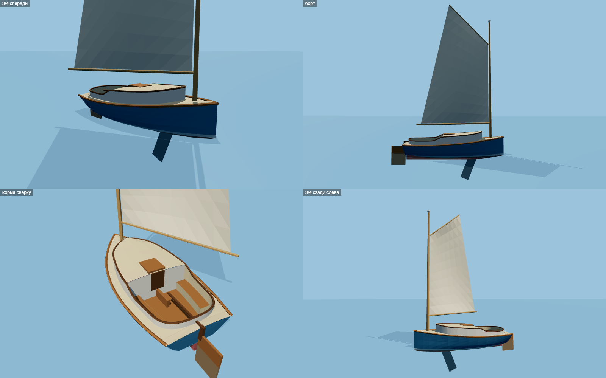
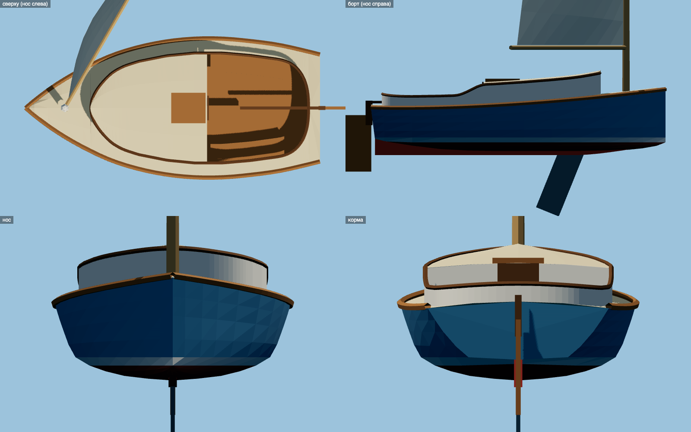

Первая версия обводов была «на глаз», и пользователь её отклонил: транец и форштевень не вертикальные, пропорции в плане не кетботовые. Тогда добавили референсы `12a.jpg` (вид сверху), `sailplan.gif` (профиль и вид с носа) и `deck_gear.gif` (план палубы), и обводы переснял по ним.

- **Обводы CatBoat 16, увеличенные в 1.2 раза** (LOA 5.0 → 6.0 м). Полуширины по планширю сняты попиксельно с `12a.jpg`. Наибольшая ширина 2.82 м приходится примерно на 60 % длины от носа, транец шириной 77 % от максимальной. Нос в плане острый, V-образный.
- **Форштевень вертикальный**, подзор скруглён за счёт нарастания глубины корпуса к ~20 % длины. **Транец почти вертикальный**, низ впереди верха на 0.08 м, нижняя кромка у самой ватерлинии.
- **Шпангоут** (`sectionCurve`) — Catmull-Rom по 6 точкам: днище с килеватостью, скула у ватерлинии, развал бортов. Ширина по ватерлинии — около 83 % от ширины по планширю, как BWL/BOA = 1.92/2.32 у прототипа. Глубина корпуса 0.28 м, киль до −0.36 м.
- **Седловатость** (`sheerAt`): у носа 0.96 м, у кормы около 0.58 м, к транцу небольшой подъём.
- **Раскладка палубы по `deck_gear.gif`**: кокпит от транца (−2.78) до переборки (−0.70), рубка от переборки до лба (1.68). Лоб рубки в плане — почти полуцилиндр (суперэллипс p=2.2 на последних 0.8 м; сначала был заострённый эллипс, по замечанию пользователя скруглил). Боковые проходы 0.28 м.
- **Комингс и стенки рубки** — одна белая стенка по контуру выреза, высота плавно растёт от 0.22 м до 0.42 м. Сверху тёмный планширь. В кокпите обшивка, банки, пол и колодец шверта. У рубки крыша с погибью, переборка, сходной люк и сдвижной люк.
- Транец красится целиком в цвет борта: иначе веер треугольников из его центра давал большие белые пятна от полосы ватерлинии.
- На стенде появились ортогональные виды `?views=ortho` (сверху, борт, нос, корма) для сверки с чертежом.

### 1.3 Руль и шверт
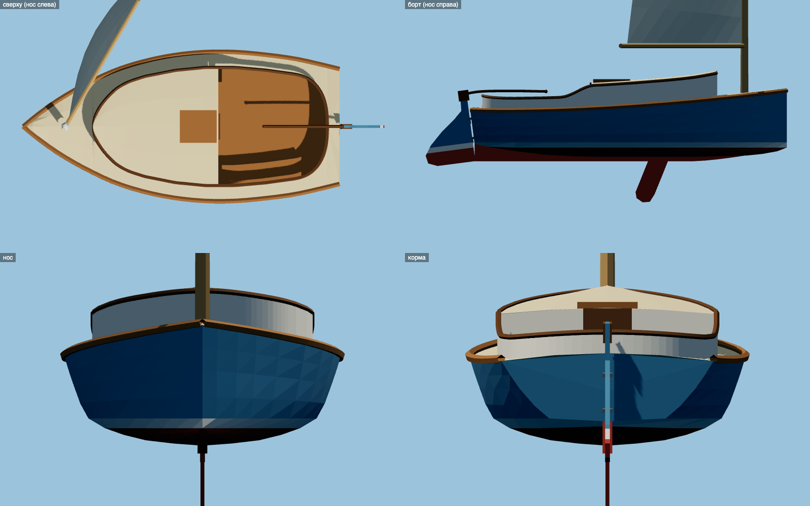
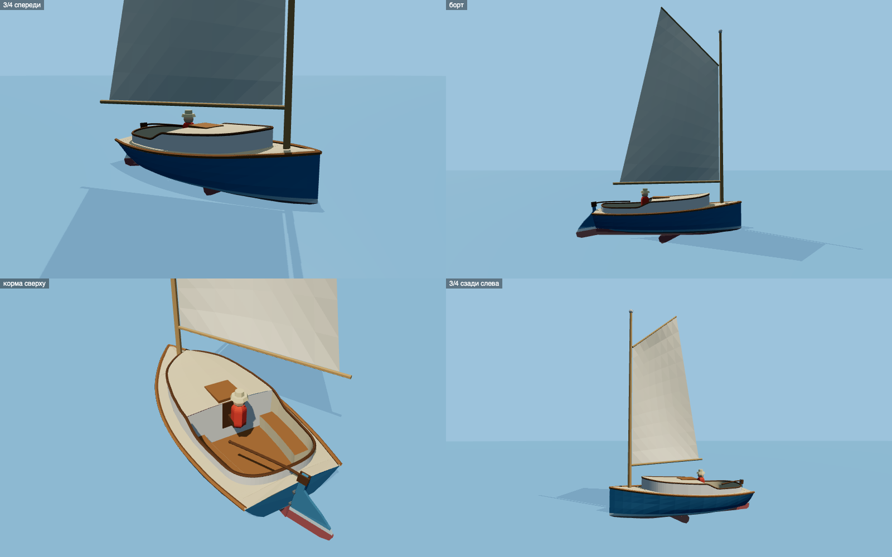

- **Навесной руль «амбарная дверь»** (контур `RUDDER` по `14sh.jpg` и `deck_gear.gif`): перо выходит за транец назад на 0.9 м, низ на уровне киля (−0.36). Голова поднята до 1.0 м, чтобы румпель прошёл над кормовым комингсом. Перо собирается из трёх пластин, нарезанных по высоте (`clipBand`), и красится как корпус: борт, белая полоса, красное днище.
- **Ось руля** (`rudderMount`) идёт вдоль наклонного транца. Перекладка (`rudderPivot.rotation.y`) делается вокруг этой наклонной оси. Румпель в СК оси опущен к концу, поэтому в лодке он почти горизонтален.
- На транце две неподвижные металлические петли, на пере штыри. Добавлен материал `metal`.
- **Шверт** — пластина `BOARD` с закруглённым концом. Ось теперь под рубкой (x = 0.6, на ВЛ). В поднятом положении шверт целиком в корпусе, опущенный выходит назад-вниз через киль. Покрашен как днище. Колодец в кокпите убран, потому что по `12a.jpg` колодец стоит в каюте. Неиспользуемый материал `board` удалён.
- Хелпер `plate(poly, t)` делает пластину из контура `[u, v]` (u → назад, v → вверх). Его можно переиспользовать для фурнитуры.

#### 1.3a Шверт крупнее, подводные контуры проще
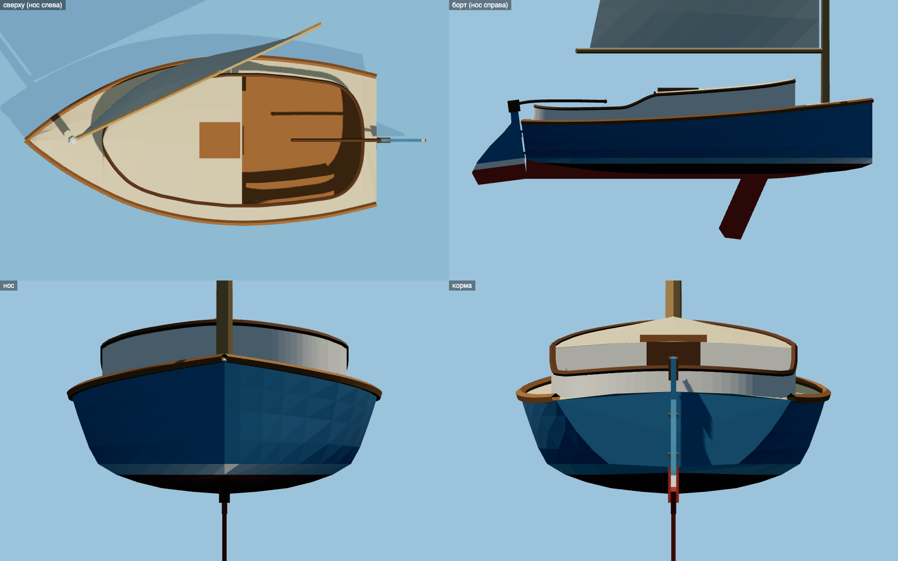
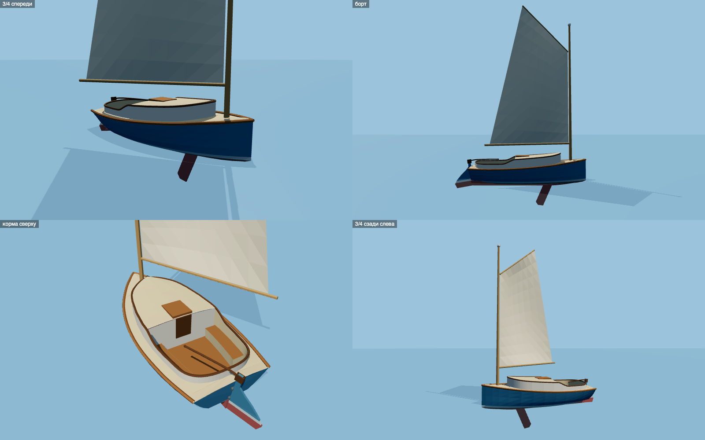

- Шверт вырос с 1.26 × 0.35 до 1.5 × 0.42 м. Ориентир — 18-футовые кетботы, у них осадка с опущенным швертом около 1.4 м. Ось перенесена вперёд на x = 1.0: поднятый шверт лежит под рубкой (до x ≈ −0.45, переборка на −0.7) и не опускается ниже киля. Угол опускания вынесен в `BOARD_DOWN` = 66°, конец уходит на ~1.4 м ниже ВЛ.
- Ради полигонов упрощены контуры: у шверта 5 точек вместо 7 (конец срезан фаской), у подводной части руля 3 точки вместо 4. Надводный силуэт руля прежний.
- Значения для этапа 2: `boardDraft` ≈ 1.4; площадь пластины ≈ 0.6 м²; центр опущенного шверта по длине около x ≈ 0.8, поднятого около x ≈ 0.3.

#### 1.2a Рубка и кокпит грубее (low-poly)
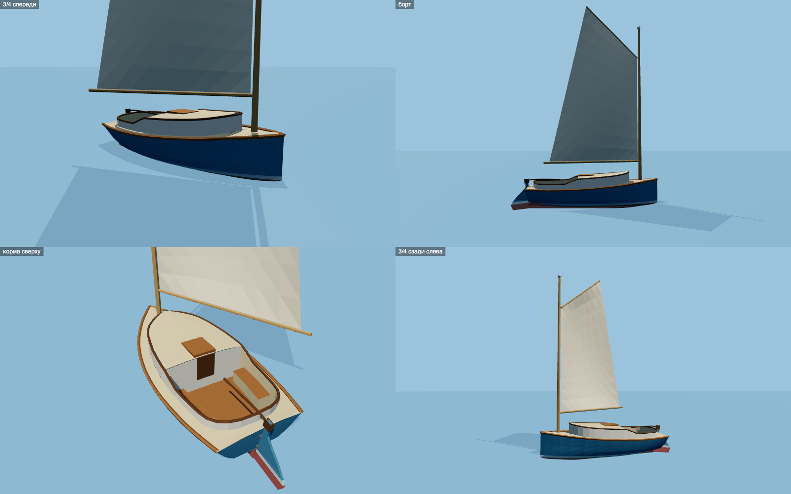
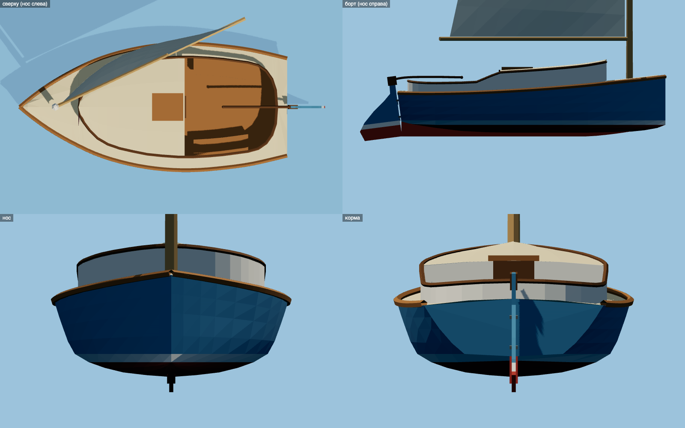

- Шагов контура выреза стало 20 вместо 64 (`OX_N`, по просьбе пользователя за две итерации: 64 → 32 → 20). От этой сетки строятся стенки рубки и комингса, обшивка, банки, крыша и кромка палубы, поэтому полигонов в них примерно втрое меньше. Лоб рубки и корма кокпита теперь гранёные.
- Планширь комингса раньше был `TubeGeometry` по сплайну Catmull-Rom. На редких точках сплайн уходил от стенки и давал щели, поэтому его заменила гранёная труба `polyTube` по той же ломаной: кольца стоят в вершинах контура и разнесены по биссектрисе, так что грани совпадают со стенкой. Полигонов в ней тоже меньше: было 200 сегментов, стало ~42.

### 1.4 Рангоут и работающий такелаж
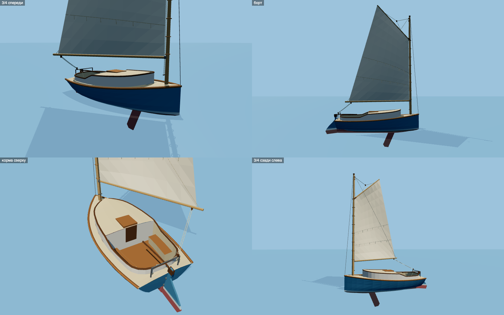
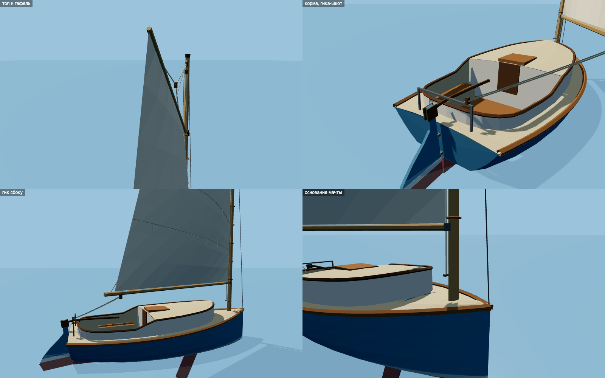
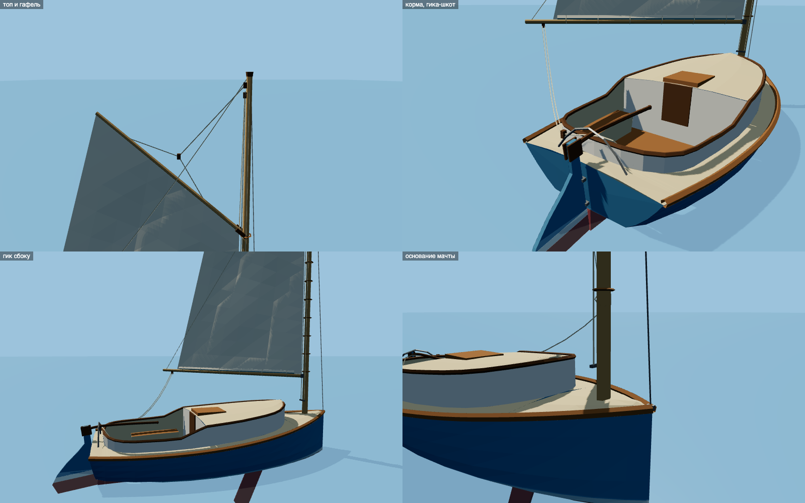
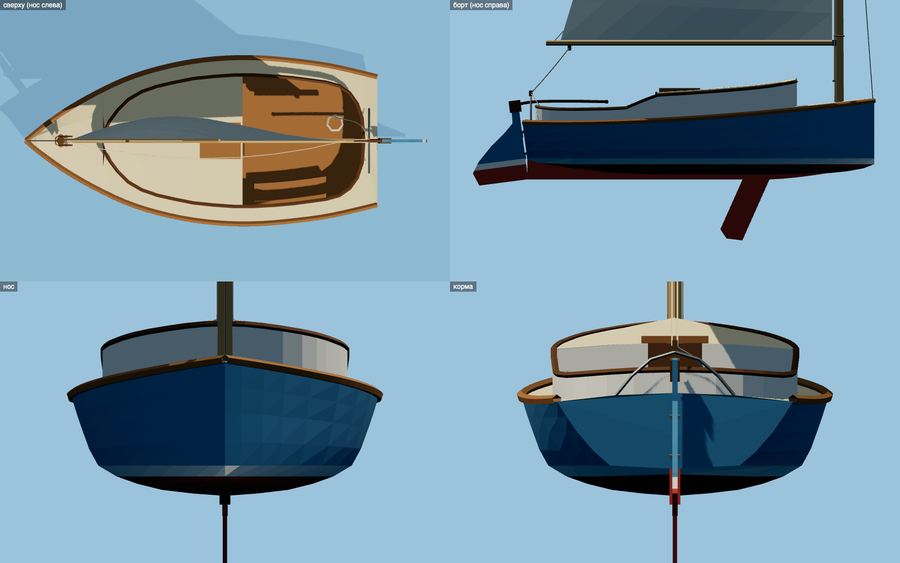

- Рангоут, парус и такелаж вынесены в новый модуль `src/scene/boat-rigging.js` (`createRig(opts)` → `{ update }`), `boat-mesh.js` передаёт туда точки корпуса: мачта, форштевень, погон, комингс, пол кокпита.
- **Мачта** перенесена на бак: x = 2.4 (0.6 м от форштевня, как на `sailplan.gif`), топ на 8.3 м над ВЛ, шестигранник с сужением. **Гик** 4.9 м на высоте ~1 м над палубой у мачты, **гафель** 3.4 м под 40° с усами вокруг мачты. Передняя шкаторина 4.6 м.
- **Тросы** — трёхгранные призмы (`makeRope`), вершины пересчитываются в кадре, буферы создаются один раз. Отдельный материал `MAT.rope`, тени тросы не отбрасывают (тонкие, давали бы шум).
- **Гика-шкот**: блок на гике → блок на погоне. Погон — металлическая арка у транца над румпелем, как на классических кетботах. Нижний блок ездит по погону к борту, куда вынесен гик. Две ветви шкота провисают, когда `sheet` больше `|boom|` (шкот потравлен, а ветер гик не выносит). Хвост шкота переваливает через кормовой комингс в бухту на полу кокпита.
- **Фалы**: фал горла с топа к горлу; фал пика с топа к блоку на уздечке, уздечка держит гафель в двух точках (25 % и 80 % длины). Ходовые концы фалов идут вдоль мачты к нагелю у её основания.
- **Топенант** с топа на нок гика, слабый: провисает и отходит на наветренную сторону, чтобы не резать пузо паруса. В плане было два топенанта; второй всегда проходил бы сквозь пузо, поэтому оставлен один.
- **Штаг** с топа на оковку форштевня (тонкий металлический трос).
- **Сегарсы** — 8 колец на мачте (тор 3×6), равномерно по текущей передней шкаторине: при рифах опускаются вместе с горлом.
- **Рифы**: вдоль гика лежит валик убранного паруса (пятигранник), толщина растёт с `reefLevel`, вокруг валика и гика — риф-сезни.
- Стенд: `?views=detail` — крупные планы такелажа.
- Для этапа 2: площадь грота по новой геометрии ≈ 21.5 м² (в `config.js` 23), геометрический центр паруса ≈ 4.6 м над ВЛ (в конфиге `ceHeight` 3.0) и примерно над x ≈ 0.5; мачта на x = 2.4.

#### 1.4a Погон рамкой, полки рифов, спущенный парус
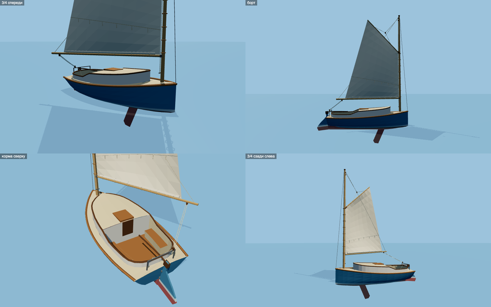
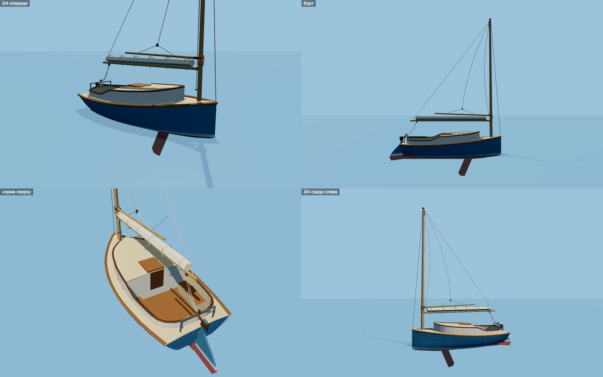

- **Погон** гика-шкота теперь П-образная рамка: две стойки и перекладина над румпелем (боксы, low-poly). Нижний блок ездит по перекладине.
- **Полки рифов**: две усиленные полосы поперёк паруса на высоте 24 % и 44 % передней шкаторины (ровно на столько её укорачивают 1-й и 2-й риф). На каждой по 6 пар риф-сезней с обеих сторон. Взятая полка уходит в валик на гике и скрывается, оставшаяся сдвигается вместе с парусом. Точки берутся с поверхности паруса (`sailPoint`), поэтому полки повторяют пузо и полоскание.
- **Спущенный парус**: новый параметр `boat.sail.furl` (0 — поднят, 1 — спущен; на стенде `?furl=1`). Он плавно опускает горло к гику и кладёт гафель почти горизонтально (40° → 2°). Парус собирается в валик на гике (r = 0.12), сезни охватывают валик вместе с гафелем, сегарсы ложатся стопкой у гика. Фалы ослаблены, топенант выбран и держит гик. Физика про `furl` пока не знает: управление и обнуление тяги — этап 2.
