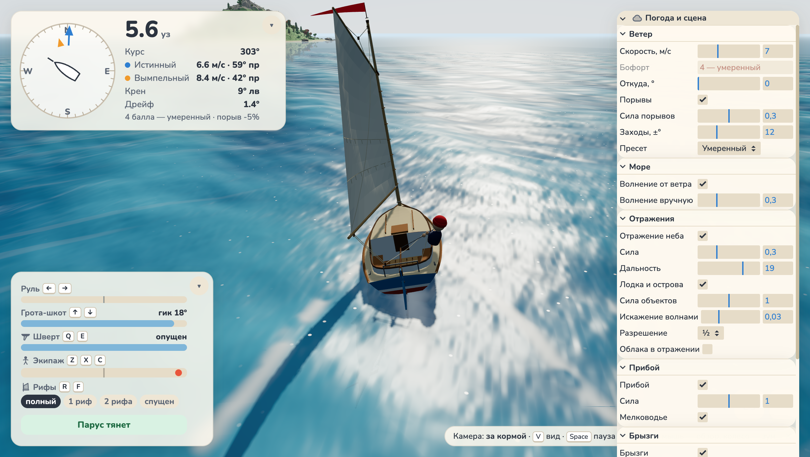
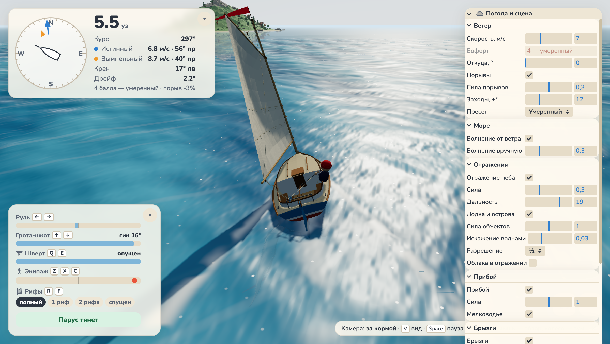
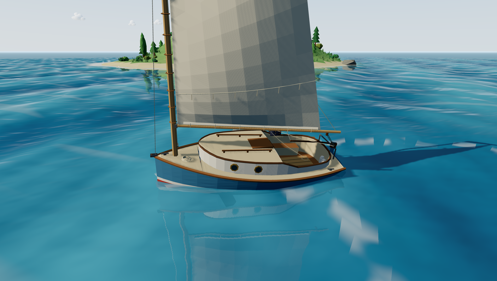

# Аудит производительности — резюме

План и исходные замеры: [plan.md](plan.md).

## Как мерить
- `?perf=1` — счётчик кадра вверху по центру: медианы GPU (timer query), CPU и интервала кадров за 60 кадров,
  draw call'ы и треугольники за все проходы кадра, текущий DPR и размер буфера. Его же включает панель
  «Производительность» → «Счётчик кадра».
- `?dpr=1.5` — зафиксировать плотность пикселей (выключает авто-разрешение); для сравнений до/после — `?dpr=2`.
- Сценарий сравнения: `?t=20&auto=1&cam=chase&dpr=2` — лодка идёт автопилотом, за ней полный след (40 точек).
- Мерить в **одной** вкладке: соседние вкладки с той же сценой делят GPU и раздувают GPU-время кадра.
- Кэш браузера держит старые модули — сервер с `Cache-Control: no-store` или вкладка в изолированном контексте.

## Шаг 1 — замеры и авто-разрешение
- Новый модуль `src/perf.js`:
  - `createPerf(renderer)` — GPU-время через `EXT_disjoint_timer_query_webgl2` (не больше 4 запросов в полёте),
    CPU кадра, интервал кадров; `renderer.info.autoReset = false`, чтобы считать вместе тени, отражение и основной проход;
  - `createAdaptiveResolution` — держит GPU-время в бюджете 11 мс: выше 12.1 мс — шаг DPR вниз на 0.25,
    ниже 6 мс — вверх; после смены 1.5 с не судит. Без таймера (iOS Safari) — только вниз, по интервалу кадров > 20 мс;
  - `createPerfOverlay` — счётчик кадра.
- `src/main.js`: потолок DPR — 2 на десктопе и **1.5 на таче**, дальше подстраивается авто. `?dpr=` фиксирует.
- Панель «Погода и сцена» → «Производительность»: «Авто-разрешение», «Плотность пикселей» (ручная — выключает авто),
  «Счётчик кадра».

## Шаг 2 — шейдер воды
Сценарий сравнения, M4, DPR 2, одна вкладка:

| | GPU кадра |
|---|---|
| до (main) | 10.70 мс |
| отсечение следа по габариту | 9.55 мс |
| + пропуск шума барашков и бликов | 9.37 мс |

- **След** (`water-fx.js` `wakeFoam`, `wake.js`): вместо круга 80 м вокруг лодки — габарит точек следа с полушириной
  уса (`uWakeBox`, считает `wake.js`). В цикле по сегментам — точный пропуск сегмента, если пиксель дальше уса и полосы
  за кормой: шум и `smoothstep` там дали бы ноль. Картинка не меняется.
- **Барашки** (`water.js`): шум рваного края считается только там, где `crest > 0`; полосы пены — только при `uWhitecap > 0`.
- **Блики** (`water-fx.js` `GLINT_GLSL`): вне солнечной дорожки (`rl ≤ 0.6`, там `rl^16 < 3·10⁻⁴`) ничего не считаем;
  шум отблеска — только при `rl > 0.95`; искра — только у ячеек с `h ≥ 0.75` (остальные и раньше гасил `step`).

До / после (кадры сняты в разные моменты, картинка совпадает: усы, пена, искры):

## Шаг 3 — draw call'ы лодки
- Новый модуль `src/scene/merge-static.js` — `mergeStatic(parent)`: неподвижные меши-дети собираются в один меш
  на материал (и флаги теней). Пропускаются меши с `userData.dynamic`, с детьми, невидимые, с мультиматериалом и
  с зеркальной матрицей. Атрибуты — position, normal (нужна и при flatShading: по ней `normalBias` теней), uv — если
  у материала есть карта. Тот же приём, что был в `boat-fittings.js`, только обобщённый.
- Вызовы: `boat-mesh.js` — корпус, `rig`, `gaffPivot`, шверт, крепление и перо руля, удлинитель румпеля;
  `sailor.js` — тело, голова, шапка; `environment.js` — буи (корпус и конус теперь одного материала).
- `userData.dynamic`: тросы и вымпел (вершины каждый кадр), парус, валик, блоки уздечки и погона, глаза (моргают),
  руки моряка.
- `boat-rigging.js`: 24 риф-сезня, 8 сегарсов и 6 сезней — три `InstancedMesh` вместо 38 мешей; у убранной полки
  рифа инстансы масштабируются в 0.
- Мешей лодки в кадре: 127 → 58.

## Шаг 4 — плоское отражение
- `planar-reflection.js`: зеркальная камера видит только слой `REFLECT_LAYER`. `markReflected(root, { minRadius })`
  включает в слой меши крупнее порога (`userData.noReflect` / `userData.reflect` — явные исключения) и источники
  света (three фильтрует свет по слою камеры).
- `main.js`: в отражении — острова без травы, буи, облака (если включено «Облака в отражении»), лодка с порогом
  0.25 м, моряк с порогом 0.1 м. Вода, небо и брызги в слой не входят, поэтому список `hide` на каждый кадр
  больше не собирается.
- Отражение: 123 → ~32 draw call'а, CPU 1.1 → 0.4 мс. Из отражения ушли тросы, ходовые огни, сегарсы и мелкая
  фурнитура — на половинном разрешении с искажением волнами их не видно (кадр ниже).

Лодка и моряк до/после слияния совпадают: `img/boat-before.png` / `img/boat-after.png`,
`img/sailor-before.png` / `img/sailor-after.png` (моряк — 132 различающихся байта из 13 млн, это моргание).

## Шаг 5 — мелочи CPU
- Без мусора для GC: `Waves.heightAt` пишет в скретч `_o`; `Wind.vector()` возвращает общий объект (читать сразу);
  `Wind.apparent(psi, u, v, out)` и `foilForces(..., out)` пишут в переданный объект; `FollowCamera.update` —
  без `new Vector3`.
- HUD (`hud.js`): `set` / `css` / `attr` пишут в DOM только изменившееся значение; предупреждения — тоже по
  изменению (раньше `innerHTML` каждые 3 кадра).
- Облака: на GPU уходят только живые матрицы (`addUpdateRange`), как у частиц.
- Тач: карта теней 1024 и `PCFShadowMap` вместо 2048 и `PCFSoftShadowMap`.
- Кольцевой буфер следа не делал: точка добавляется раз в 0.8 м пути, выигрыша нет.

## Итог
M4, Chrome, DPR 2 (2400×1356), одна вкладка.

| Сценарий | | GPU | CPU кадра | Draw call'ы |
|---|---|---|---|---|
| за лодкой, полный след (`?t=20&auto=1&cam=chase`) | до | 10.7 мс | 2.2 мс | 389 |
| | после | 9.0 мс | 1.8 мс | 152 |
| шторм, кадр на паузе (`…&wind=16`) | до | 8.9 мс | 2.0 мс | 329 |
| | после | 9.3 мс | 1.0 мс | 145 |
| тач (`?touch=1`, авто DPR 1.5, без отражения) | после | 9.3 мс | 1.8 мс | 116 |

- **GPU-время на Apple плавает с частотой.** Разброс одного и того же кадра — ±0.4 мс. При малой нагрузке GPU
  сбрасывает частоту, и тот же кадр «стоит» дольше: на таче при DPR 1.5 вышло 9.3 мс, как при DPR 2, а выключение
  отражения дало 9.8 мс вместо 9.1. Поэтому разница в шторме (8.9 → 9.3) — в пределах шума. Что ветки шейдера
  помогают, видно по откату внутри одной сборки: убрать любую из них — кадр дорожает на 0.2–0.3 мс.
  Надёжные метрики — draw call'ы и CPU; GPU сравнивать только с большими отличиями.
- Авто-разрешение снижает DPR только при GPU > 12.1 мс — на малых нагрузках завышенные показания его не трогают.
  Повышает — только при < 6 мс.
- Физика не изменилась: 60 с симуляции под автопилотом совпадают с main до 12 знаков, поляра в JSC
  (`run-polar.mjs`) — построчно.

## Что не сделано
- LOD шейдера воды по расстоянию: октавы ряби уже гаснут по `fpx`, а у горизонта узкая полоса — выигрыш не стоит
  риска для картинки. Стандартный PBR воды (~1.8 мс на M4) остаётся самым дорогим куском.
- Тросы (9 мешей) остались отдельными: у них разные родители (лодка и гик).
- На реальном телефоне не мерили — только эмуляция `?touch=1` на M4.
