# Модель моряка-рулевого — резюме

План: [plan.md](plan.md). Референсы: `references/chars/saillor_reference/` (развёртка — файл `sailor sitting.jpg`, поза сидя — `sailor t-pose sideviews.jpg`, имена перепутаны), стиль — `references/chars/crops_from_video/`.

## Инструменты
- `src/debug/sailor-viewer.html` — стенд моряка: 4 ракурса как в развёртке (спереди, 3/4, сбоку, сзади). Открывать с корня проекта: `http://127.0.0.1:8080/src/debug/sailor-viewer.html`. Параметры URL: `yaw`, `pitch` (поворот головы, °), `blink` (0..1), `views=hero`, `t`.

## Этап 1 — модель, посадка, анимация

### 1.1 Модель

Новый модуль `src/scene/sailor.js`, `createSailor()` → `{ group, head, body, hands, eyes, update(dt, ctx), eyeWorld }`. Локальная СК: лицом к +Z, начало на сиденье под центром тела.

- **Размеры** сняты с развёртки. От сиденья до макушки шапки ≈ 1 м, тело высотой 0.48 м, полуширина 0.225 у живота и ~0.18 на уровне плеч, голова r = 0.197, руки r = 0.058.
- **4 части, как просили**:
  - голова — `Group` с шарниром у основания шеи (y = 0.47), чтобы повороты и кивки шли от воротника; в ней шар, глаза и шапка;
  - тело — `Group` бушлата;
  - две руки-сферы.
- **Тело — «сплющенная капля», не тело вращения.**
  - В анфас профиль `BODY_FRONT`: плечи заметно уже низа, самое широкое место («пузо») на середине высоты тела (y ≈ 0.22–0.24 из 0.48), к дну чуть сужается.
  - Глубина задаётся долями полуширины, отдельно для переда (`K_FRONT`) и спины (`K_BACK`). Развёртка `LatheGeometry` по фронтальному профилю сжимается по z (`toDrop`): грудь полого опускается к животу, спина почти прямая.
  - Накладки и пуговицы ставятся на эту же поверхность через `bodyPoint(θ, y, off)`.
- **Голова стоит на теле, не утоплена в воротник.** Под ней шея, в вырезе над круглым воротом тельняшки видна кожа. Ворот с белой окантовкой — накладки `surfacePatch` поверх полосатой вставки.
- Глаза — сплюснутые чёрные сферы на высоте центра головы, как на референсе. Ориентированы по нормали, моргание через `scale.y`.
- **Шапка** — отдельная `Group` с шарниром точно в центре шара головы, без смещения. Наклон назад 0.17 рад к горизонту: так как шарнир в центре шара, шапка при наклоне остаётся плотно на голове. Внутренний радиус отворота равен сечению головы на высоте его нижней кромки: `CUFF_R = √(R² − CUFF_LO²)`, отворот от 0.03 до 0.16 над центром головы (по просьбе надета глубже, было 0.06–0.19). Купол плюс отворот-валик с 28 рубчиками (смещение вершин развёртки). Шов `LatheGeometry` уведён назад, вершины слиты (`mergeVertices`).
- **Бушлат**:
  - Лацканы с вырезом-ступенькой, вставка-тельняшка в V-вырезе и кромка запаха сделаны накладками `surfacePatch`: контур в координатах «дуга от середины груди × высота» выдавливается, тесселируется и обтягивает тело.
  - Тельняшка — `CanvasTexture` с периодом полосы 4.5 см.
  - Воротник сзади — полоса-развёртка вокруг шеи. 4 латунные пуговицы в два ряда.
- **Материалы** гладкие (`MeshStandardMaterial` без `flatShading`), свои в модуле: кожа, бушлат, лацканы (на тон светлее, чтобы читались), тельняшка, латунь, шерсть, глаза.
- Рукава-«культи», которые видны на позе сидя в референсе, не делал: по договорённости руки — только сферы.
- Правки после показов:
  1. Тело было бочонком (тело вращения с прямыми боками), голова утоплена в воротник, шапка сидела горизонтально.
  2. Шапку сдвигало на затылок, и она висела над головой; не было ворота тельняшки с кожей; пузо было слишком низко.

#### Документ по геометрии стиля
Форма тела, посадка головы и головного убора, руки, цвета и блок пропорций для генераторов картинок записаны в `references/chars/style-geometry.md`. Размеры там даны в радиусах головы, чтобы по ним строить других персонажей. Ссылки на документ добавлены в `info.md` и `prompt.md`; устаревшие пункты стиля в `info.md` («голова сливается с телом») исправлены.

### 1.2 Посадка в лодку: 4 положения
| | банка (ближе к ДП) | откренка (на комингсе) |
|---|---|---|
| правый борт |  | 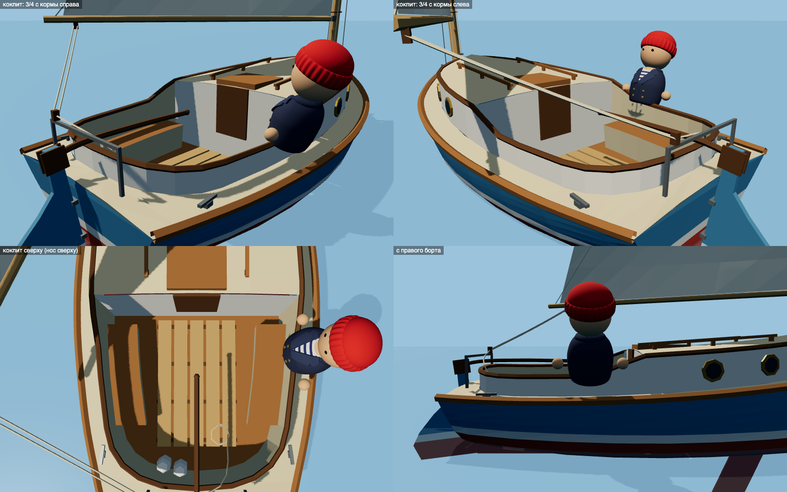 |
| левый борт | 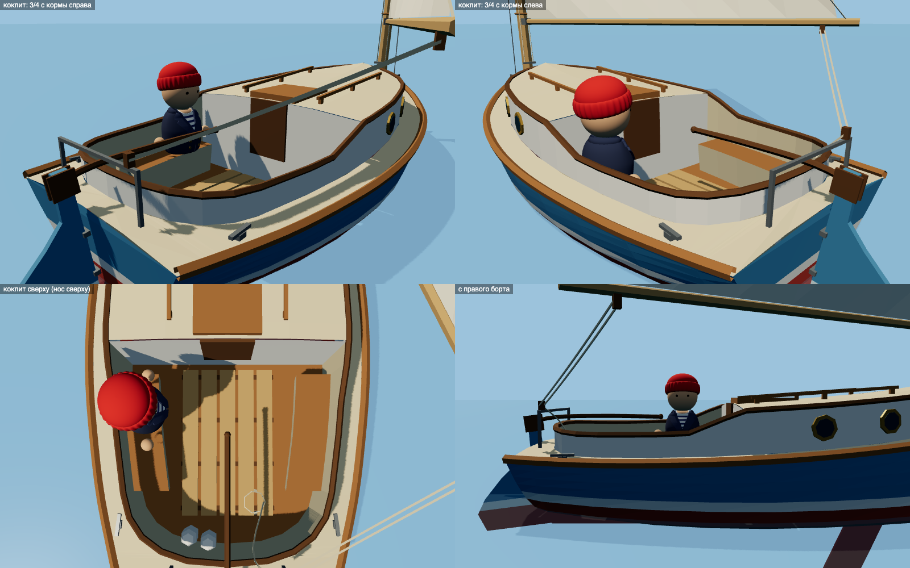 | 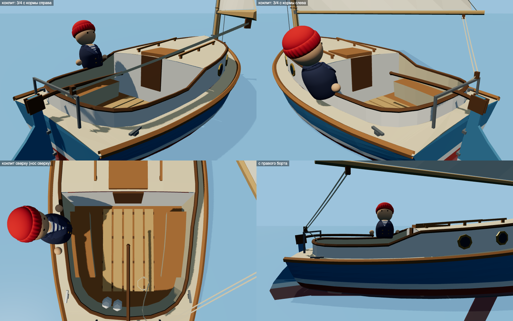 |

- Старый рулевой в `boat-mesh.js` (капсула, сфера, шляпа, коробка-ноги) заменён на `createSailor()`. Материалы `skin`, `shirt`, `hat` удалены из `MAT` лодки, у моряка они свои. Интерфейс `createBoatMesh()` прежний, в возвращаемый объект добавлен `sailor` (для стенда и анимаций).
- **Точки сидений** считает `seatPose(side, hike)` из геометрии кокпита (`outlineW`, `edge`, `CK`). Моряк сидит лицом к противоположному борту на x = −1.3, чуть впереди конца румпеля (≈ −1.55), чтобы кормовая рука доставала до румпеля.
  - **банка**: сиденье y = `floorY + seatH` = 0.5, центр тела в 0.12 м от внутренней кромки банки (было 0.19: спина просвечивала сквозь комингс); пузо свисает за кромку;
  - **откренка**: дно тела на 3 см ниже верха комингса (`edge.top` − 0.03, было +0.035), тело слегка пересекается с комингсом. Центр над комингсом, так что пузо над банкой, спина над боковым проходом. Корпус наклонён за борт на 0.35 рад (~20°) вокруг точки посадки, голова выходит за линию борта.
- **Связь с физикой до этапа 2**: стенд задаёт положение напрямую (`boat.crewSeat`). В игре борт берётся из `sign(crewY)`, при `crewY = 0` — наветренный борт по `aw.twa`; откренка включается при `|crewY| > 0.6·crewMaxY`. Переход пока скачком, плавная пересадка будет в 1.4.
- `eyeWorld` теперь берёт глаза моряка. `sailor.update(dt)` вызывается каждый кадр, `dt` считается по `time`.
- Стенд: `boat-viewer.html?views=crew&seat=stbd-hike` (`port-bench|port-hike|stbd-bench|stbd-hike`). Ракурсы: 3/4 с кормы с обоих бортов, сверху (нос сверху), с правого борта.
- Игра (`index.html`) запускается без ошибок и предупреждений в консоли.
- Руки пока в позе покоя, румпель и шкот — шаг 1.3.
- **Масштаб ×1.1** (по просьбе): `SAILOR_SCALE` в `sailor.js` применяется к группе моряка. Геометрия и таблицы в `style-geometry.md` остаются для R = 0.197, в игре R = 0.217 м, от сиденья до макушки ≈ 1.05 м. Точки посадки не менялись: начало СК моряка — на сиденье.

### 1.3 Руки: румпель и шкот
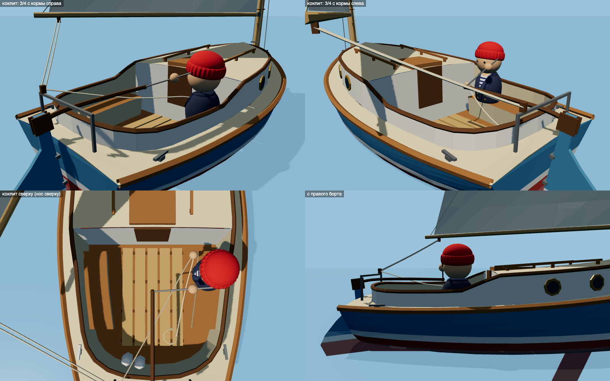
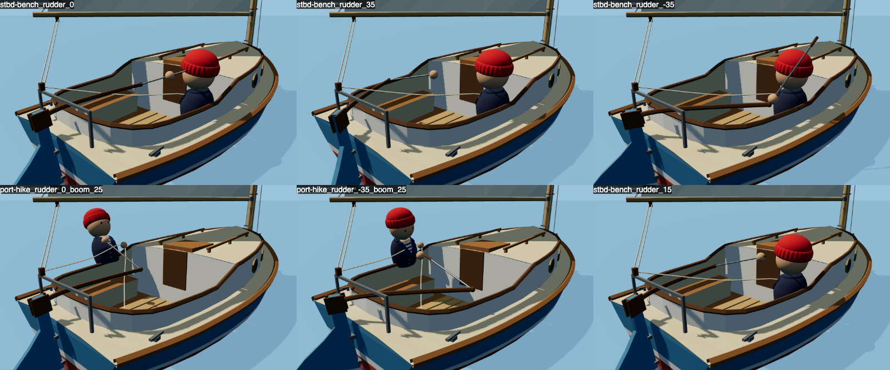

- **Какая рука что держит.** Моряк сидит лицом к противоположному борту, поэтому на правом борту корма у его правого бока (`hands[1]`, +X), на левом — у левого (`hands[0]`). Кормовая рука на румпеле, передняя на шкоте.
- **Цели рук** задаёт `boat-mesh.js` в мировых координатах и передаёт в `sailor.update(dt, { hands })`. Моряк переводит их в свою СК, ограничивает досягаемостью `SAILOR_REACH` = 0.75 (×1.1) от «плеча» и догоняет пружиной с критическим демпфированием (ω = 18), чтобы рука не дёргалась на волне.
- **Удлинитель румпеля** (без него при руле, переложенном от рулевого, рука не доставала до румпеля — конец уходил на 1–1.5 м).
  - Металлическая трубка 1.0 м с деревянной ручкой на шарнире у конца румпеля. Ориентация считается в кадре в СК лодки.
  - **Рулевой всегда держится за удлинитель.** Свободный конец смотрит вверх и назад, на точку над кормовым «плечом» рулевого и чуть за спиной (0.45 м над плечом, 0.18 м назад).
  - Рука скользит вдоль удлинителя: берётся за точку, ближайшую к удобному положению руки (у бока, чуть впереди). Когда румпель рядом, рука у основания, а конец удлинителя торчит вверх над плечом; когда румпель далеко, рука уходит к концу.
  - Коллизии удлинителя с окружением и рулевым не учитываются (по решению пользователя).
  - **Сначала рука, потом руль.** При перекладке рука быстро скользит по удлинителю к удобной точке для нового угла руля (`GRIP_TAU` = 0.035 с, 95 % за ~0.1 с), видимый руль (`visRudder`) догоняет физический только когда рука почти на месте (`RUDDER_RATE` = 30/с, умножается на «готовность» хвата). Физика берёт `boat.rudder` напрямую, управляемость не меняется. Замер на стенде: ступенька 0 → 30° — руль на месте через 0.1–0.13 с; перекладка 60°/с — видимый руль отстаёт на 1–3°. Для отладки `createBoatMesh()` отдаёт `rudderState()`.
  - Без рулевого (вид с палубы) удлинитель лежит на румпеле.
  - Первая версия складывала удлинитель вдоль румпеля, пока до конца румпеля можно дотянуться, и брала румпель рукой; заменена по просьбе пользователя.
- **Наклон торса.** Тело и голова — в группе `torso` с шарниром в точке посадки. Если цель руки дальше досягаемости, торс наклоняется к ней (до 0.55 рад, сглаживание ~6/с). Плечи считаются с учётом наклона. С удлинителем это нужно только в крайних случаях, когда рука у самого конца удлинителя.
- **Шкот.** Передняя рука держится перед животом с передней стороны. Скорость изменения `sail.sheet` сглаживается: когда шкот травят, рука уходит к блоку (до 0.12 м), когда выбирают — тянет к себе (до 0.1 м).
- **Хвост гика-шкота идёт через руку.** `rig.update(boat, time, sheetHand)`: блок на погоне → небольшой провис → рука → бухта на полу. Без моряка хвост идёт как раньше, через комингс. `createRig` теперь отдаёт и `sheetBlock` — позицию нижнего блока.

### 1.4 Фоновые анимации
| | |
|---|---|
| 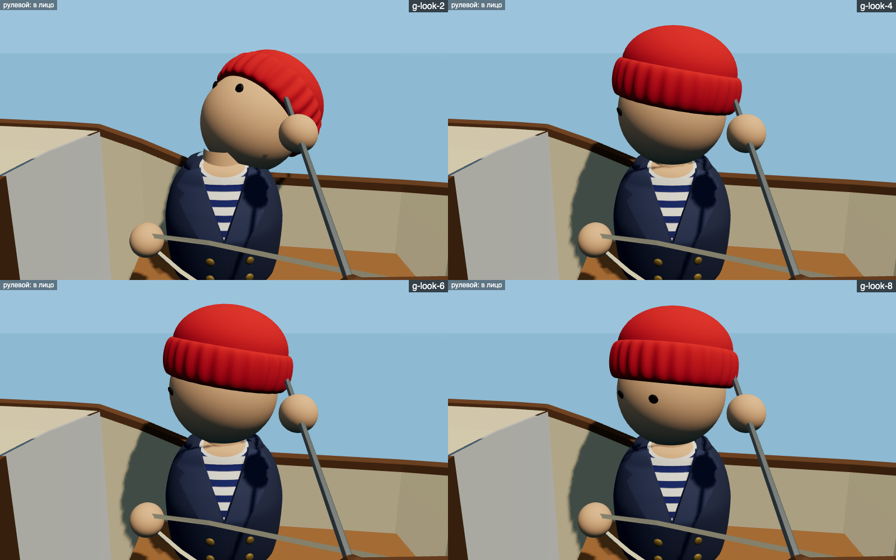 | 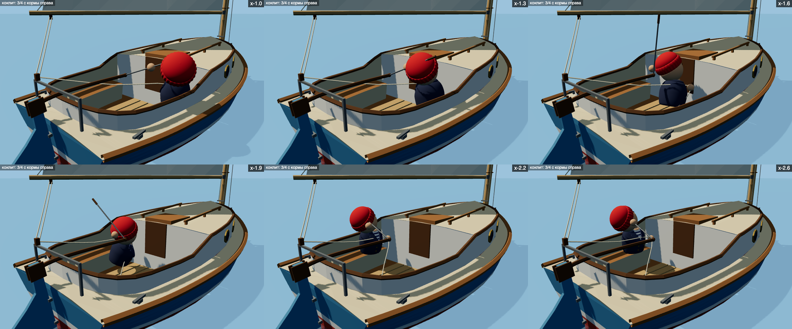 |
| взгляд, t = 2 / 4 / 6 / 8 с | пересадка с правой банки на левую, t = 1.0…2.6 с |
| 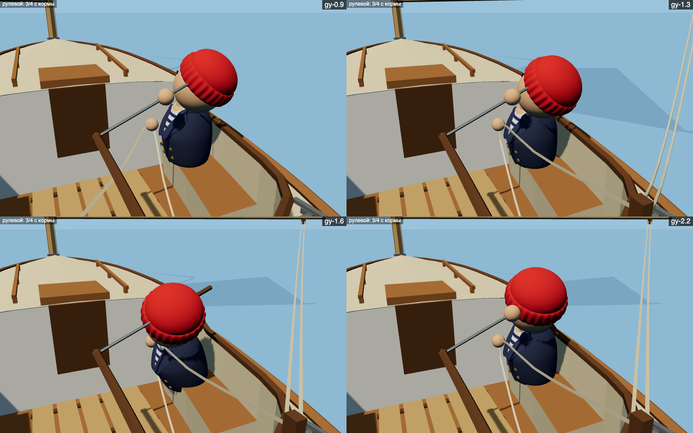 | 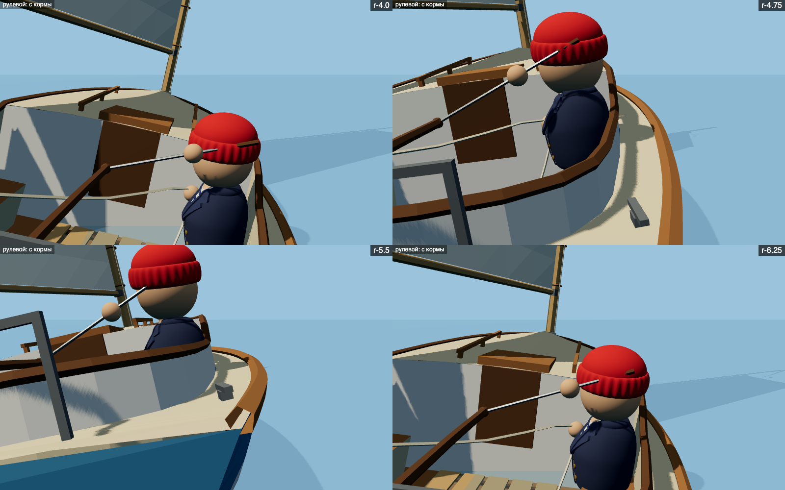 |
| фордевинд: гик переходит в t = 1 с | качка ±15°, вертикальная ±0.25 м |

Контроллер — в `sailor.js` (`update(dt, ctx)`), сценарии пересадки и манёвров — в `boat-mesh.js`. Случайность — детерминированная (`createSailor({ seed })`, mulberry32): кадры на стенде повторяются.

- **Взгляд.** `ctx.lookAt = { course, sail, pennant }` — мировые точки: далеко по курсу, середина паруса (`rig.sailLook`, двигается с гиком), вымпел (`rig.pennantLook`). Плюс «по сторонам» (случайный угол). Выбор взвешенный, без повтора (`LOOK_W`), пауза на цели 1–6 с (`LOOK_HOLD`). Голова поворачивается пружиной ω = 9 с пределами: рыскание ±1.5 рад, кивок −0.45…+0.9. `ctx.look` по-прежнему задаёт угол вручную (стенд моряка).
- **Моргание** раз в 2–5 с, 0.12 с, в 20 % случаев — дважды подряд. **Дыхание** — период 4.2 с: тело ±1.2 % по высоте (и чуть уже), голова поднимается вместе с ним и слегка кивает.
- **Крен и дифферент.** `ctx.refUp` — «верх» лодки. Торс компенсирует 45 % отклонения от вертикали, голова — 75 % (не больше 0.4 рад, сглаживание ~5/с). Наклон откренки при этом сохраняется: компенсируется только разница между вертикалью и «верхом» лодки.
- **Волна.** Вертикальное ускорение точки посадки раскачивает две пружины: торс (ω = 9) и голову (ω = 6, мягче, с запаздыванием) — ±3–4 см.
- **Пересадка** (`boat-mesh.js`). При смене сиденья поза плавно переходит из текущей в новую (`smootherstep`):
  - через кокпит (смена борта) — 1.4 с: разворот лицом к носу (`turnTarget` выбирает кратчайший путь, при 180° — через нос), проходит на 8 см ниже, пригибается (`duck`), руки меняются на середине перехода;
  - банка ↔ комингс — 0.5 с.
  - Прерванная пересадка продолжается из текущей позы.
- **Пригибание** (`ctx.duck` 0..1): торс вперёд на 0.42 рад, тело приседает на 10 %, голова опускается.
- **Манёвры.** Гик перешёл на другой борт (знак `sail.boom` при |boom| > 0.1 рад): фордевинд (`sail.gybing` или |awa| > 90°) — сильно пригнуться (0.9, 1 с) и смотреть на парус 1.8 с; оверштаг — слегка (0.35, 0.8 с), взгляд на парус 1.3 с. До этапа 2 манёвр угадывается по гику, на этапе 2 событие придёт из физики.
- **Стенд** `boat-viewer.html`: `seat2=…&at=1` (пересесть в момент at), `boom2=…&at=1` (переброска гика за 0.4 с), `rock=15` (качка), `views=helm` (рулевой на правом борту крупно), `live=1` (анимация в реальном времени).

## Этап 2 — физика и управление

### 2.1 Четыре положения рулевого
- **Физика** (`src/physics/boat.js`). `boat.crewPos` ∈ `CREW_POSITIONS` = [−2, −1, 1, 2]: откренка L, банка L, банка R, откренка R (знак — борт, + правый, |2| — откренка). 0 после `reset` — на первом шаге выбирается наветренная банка (по `aw.twa`, уже посчитанному на этом шаге). Положения в ДП больше нет.
  - `crewTarget` = борт × (`crewBenchY` = 0.75 м на банке | `crewMaxY` = 1.25 м в откренке) — `src/config.js`. Откренка осталась прежней (1.25 м), поэтому крен и скорость в установившемся режиме не изменились.
  - `crewRate` 1.6 → 1.1 м/с: пересадка через кокпит ≈ 1.4 с, банка ↔ комингс ≈ 0.45 с — совпадает с анимацией из 1.4.
  - `boat.crewSeat = { side, hike }` — для модели; `boat-mesh.js` берёт сиденье только отсюда (угадывание по `crewY` убрано).
  - `crewMove(pos, action)` — следующее положение: `'left'`/`'right'` — шаг по цепочке (на краях остаётся), `'swap'` — на другой борт в то же положение.
  - `controls.crewPos` (необязательно) задаёт положение напрямую — им пользуются автопилот `?t=` (откренка на наветренном борту) и полярка.
- **События манёвров из физики**: `boat.maneuver = { count, type }`, `count` растёт на каждом повороте. Фордевинд — начало переброски гика (`sail.gybing` false → true), оверштаг — вымпельный ветер сменил борт носом к ветру (|awa| < 90°, порог 3°). `boat-mesh.js` запускает жест по `count`; на стенде (без `boat.maneuver`) — как раньше, по гику.

### 2.2 Управление
Схема, выбранная пользователем: **шаг влево/вправо + смена борта**.

| Клавиша | Тач | Действие |
|---|---|---|
| Z | ◀ | на шаг к левому борту: откренка R → банка R → банка L → откренка L |
| C | ▶ | на шаг к правому борту |
| X | ⇄ | на другой борт в то же положение (банка ↔ банка, откренка ↔ откренка) — при повороте |

- `src/input.js`: Z/X/C больше не хранят `input.crew`, а шлют событие `crew` (`'left' | 'swap' | 'right'`); в `controls` поля `crew` нет. `src/main.js` применяет `crewMove` к `boat.crewPos`; сброс лодки (`placeBoat` → `reset`) снова сажает на наветренную банку.
- `src/ui/touch.js`: кнопки ◀ ⇄ ▶ шлют то же событие; подсветка «текущего положения» убрана (у шага и смены борта её нет).
- Справка в `index.html` и `README.md` обновлена. Индикатор «Экипаж» в HUD прежний: `crewY / crewMaxY`.

### 2.3 Камера с палубы
| банка | откренка |
|---|---|
| 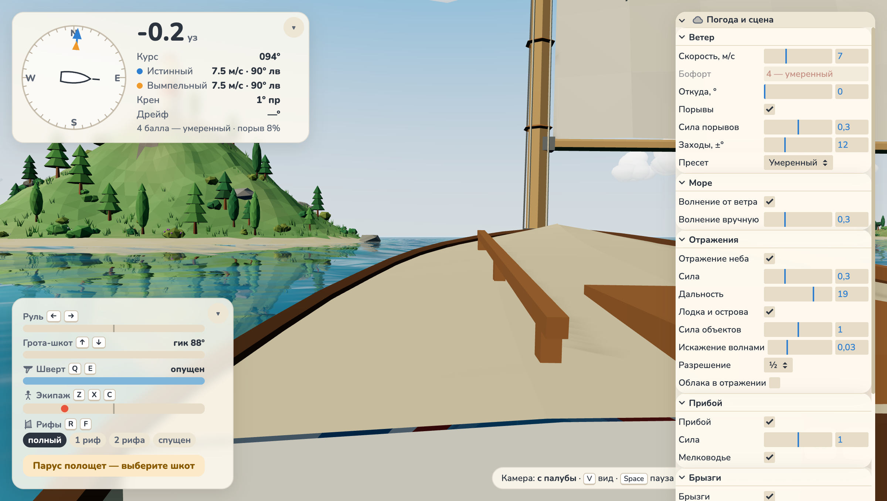 | 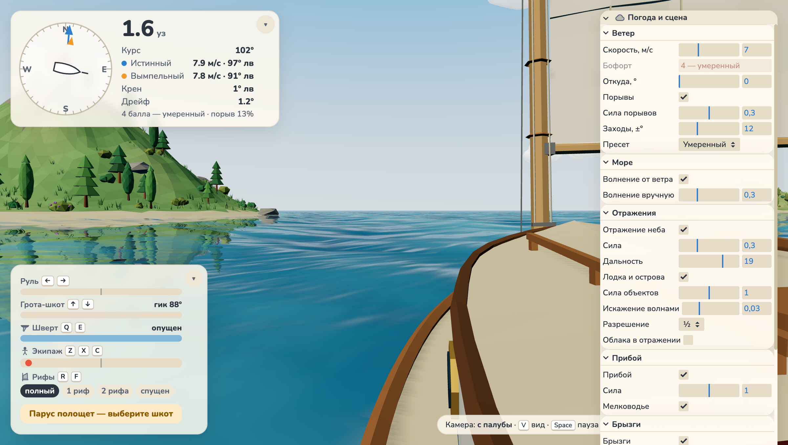 |

`sailor.eyeWorld` теперь считает глаз в СК посадки (группа моряка: 15 см над центром головы — `EYE_UP`, по просьбе пользователя, — и 12 см вперёд), а не от головы: повороты головы, дыхание, качка тела и пригибания камеру не дёргают, а наклон откренки и пересадка учитываются. Гик в откренке обзор не перекрывает. На банке крыша рубки близко и занимает низ кадра; после подъёма глаза на 15 см горизонт и вода видны над ней.

### 2.4 Полярка до/после (`jsc -m src/debug/run-polar.mjs`)
- Все таблицы с откренкой: скорость, VMG, средний крен, дрейф и угол руля **без изменений**. Максимальный крен на разгоне +0.3…+0.9° (рулевой медленнее пересаживается в начале прогона: `crewRate` 1.1).
- TWS 16 без откренки: раньше «экипаж в центре», теперь «рулевой на наветренной банке». На острых курсах лодка по-прежнему ложится (опрокидывание на 0.3–1.8 с позже); на 90° вместо лежания на 46° — опрокидывание на 9.6 с: режим на грани, при 16 м/с без рифов и без откренки всё равно не идёт.
- Проверка в игре: Z/X/C переключают положения и пересадку (лог `crewPos/crewY` из консоли), ошибок в консоли нет.
