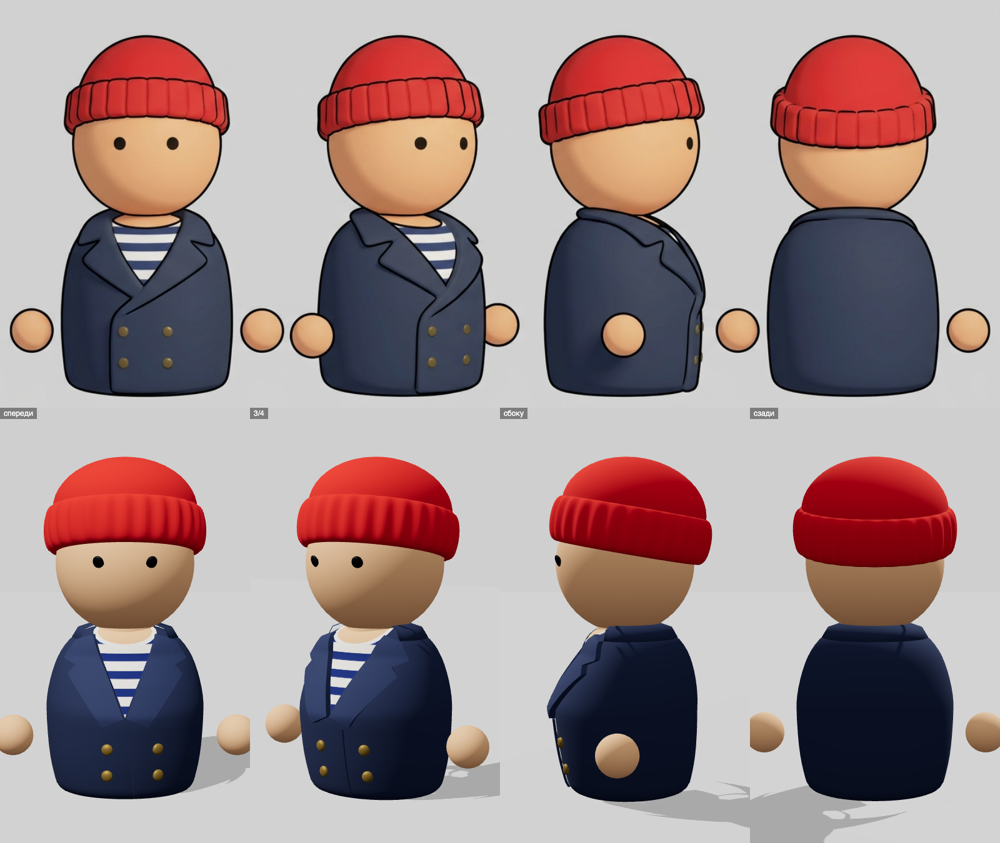

# Модель моряка-рулевого — резюме

План: [plan.md](plan.md). Референсы: `references/chars/saillor_reference/` (развёртка — файл `sailor sitting.jpg`, поза сидя — `sailor t-pose sideviews.jpg`, имена перепутаны), стиль — `references/chars/crops_from_video/`.

## Инструменты
- `src/debug/sailor-viewer.html` — стенд моряка: 4 ракурса как в развёртке (спереди, 3/4, сбоку, сзади). Открывать с корня проекта: `http://127.0.0.1:8080/src/debug/sailor-viewer.html`. Параметры URL: `yaw`, `pitch` (поворот головы, °), `blink` (0..1), `views=hero`, `t`.

## Этап 1 — модель, посадка, анимация

### 1.1 Модель

Новый модуль `src/scene/sailor.js`, `createSailor()` → `{ group, head, body, hands, eyes, update(dt, ctx), eyeWorld }`. Локальная СК: лицом к +Z, начало на сиденье под центром тела.

- **Размеры** сняты с развёртки. От сиденья до макушки шапки ≈ 1 м, тело высотой 0.48 м, полуширина 0.225 у живота и ~0.18 на уровне плеч, голова r = 0.197, руки r = 0.058.
- **4 части, как просили**:
  - голова — `Group` с шарниром у основания шеи (y = 0.47), чтобы повороты и кивки шли от воротника; в ней шар, глаза и шапка;
  - тело — `Group` бушлата;
  - две руки-сферы.
- **Тело — «сплющенная капля», не тело вращения.**
  - В анфас профиль `BODY_FRONT`: плечи заметно уже низа, самое широкое место («пузо») на середине высоты тела (y ≈ 0.22–0.24 из 0.48), к дну чуть сужается.
  - Глубина задаётся долями полуширины, отдельно для переда (`K_FRONT`) и спины (`K_BACK`). Развёртка `LatheGeometry` по фронтальному профилю сжимается по z (`toDrop`): грудь полого опускается к животу, спина почти прямая.
  - Накладки и пуговицы ставятся на эту же поверхность через `bodyPoint(θ, y, off)`.
- **Голова стоит на теле, не утоплена в воротник.** Под ней шея, в вырезе над круглым воротом тельняшки видна кожа. Ворот с белой окантовкой — накладки `surfacePatch` поверх полосатой вставки.
- Глаза — сплюснутые чёрные сферы на высоте центра головы, как на референсе. Ориентированы по нормали, моргание через `scale.y`.
- **Шапка** — отдельная `Group` с шарниром точно в центре шара головы, без смещения. Наклон назад 0.17 рад к горизонту: так как шарнир в центре шара, шапка при наклоне остаётся плотно на голове. Внутренний радиус отворота равен сечению головы на высоте его нижней кромки: `CUFF_R = √(R² − CUFF_LO²)`, отворот от 0.03 до 0.16 над центром головы (по просьбе надета глубже, было 0.06–0.19). Купол плюс отворот-валик с 28 рубчиками (смещение вершин развёртки). Шов `LatheGeometry` уведён назад, вершины слиты (`mergeVertices`).
- **Бушлат**:
  - Лацканы с вырезом-ступенькой, вставка-тельняшка в V-вырезе и кромка запаха сделаны накладками `surfacePatch`: контур в координатах «дуга от середины груди × высота» выдавливается, тесселируется и обтягивает тело.
  - Тельняшка — `CanvasTexture` с периодом полосы 4.5 см.
  - Воротник сзади — полоса-развёртка вокруг шеи. 4 латунные пуговицы в два ряда.
- **Материалы** гладкие (`MeshStandardMaterial` без `flatShading`), свои в модуле: кожа, бушлат, лацканы (на тон светлее, чтобы читались), тельняшка, латунь, шерсть, глаза.
- Рукава-«культи», которые видны на позе сидя в референсе, не делал: по договорённости руки — только сферы.
- Правки после показов:
  1. Тело было бочонком (тело вращения с прямыми боками), голова утоплена в воротник, шапка сидела горизонтально.
  2. Шапку сдвигало на затылок, и она висела над головой; не было ворота тельняшки с кожей; пузо было слишком низко.

#### Документ по геометрии стиля
Форма тела, посадка головы и головного убора, руки, цвета и блок пропорций для генераторов картинок записаны в `references/chars/style-geometry.md`. Размеры там даны в радиусах головы, чтобы по ним строить других персонажей. Ссылки на документ добавлены в `info.md` и `prompt.md`; устаревшие пункты стиля в `info.md` («голова сливается с телом») исправлены.
